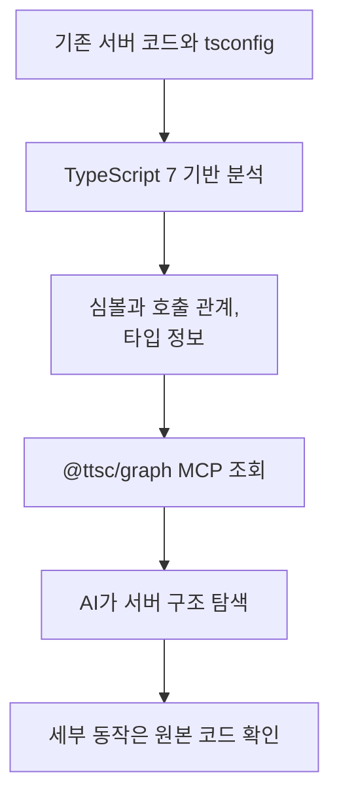

# AI용 TypeScript 코드 그래프 분석 환경

[AI 개발 품질 자동화 환경](README.md)으로 돌아갑니다.

기존 서버의 TypeScript 버전과 lockfile을 바꾸지 않으면서 AI가 심볼, 타입과 함수 호출 관계를 조회할 수 있도록 TypeScript 7 기반 코드 그래프 MCP를 외부 호스트로 분리했습니다.

[코드 저장소](https://github.com/KimHG1995/ts-graph-tools)

## 기본 정보

| 항목 | 내용 |
| --- | --- |
| 작업 기간 | 2026-07-22, 약 1일. 커밋 기록 기준 |
| 맡은 범위 | 외부 분석 도구 실행 환경, 프로젝트별 MCP 등록 스크립트와 사용 안내 작성 |
| 개발 상태 | 연결 스크립트와 실행 환경 구성 |
| 운영 상태 | 로컬 프로젝트에 등록해 사용하는 개발 도구로 구성 |

## 배경과 과제

대상 서버의 TypeScript 버전과 의존성을 변경하지 않고도 AI가 여러 파일에 걸친 함수 호출, 타입 관계를 파악할 수 있는 분석 도구가 필요했습니다.

기존 빌드와 타입 검사 체계는 그대로 유지하고 TypeScript 7 기반 분석 환경을 외부에 분리해 MCP로 연결하는 방식을 선택했습니다.

## 기술 스택

| 구분 | 기술 |
| --- | --- |
| 등록 스크립트 | Bash |
| 실행 환경 | Node.js, npm |
| AI 도구 연결 | MCP, Claude Code CLI |
| 코드 분석 | @ttsc/graph, ttsc, TypeScript 네이티브 검사기 |

## 어떻게 해결했는지

### 대상 프로젝트에 흔적을 남기지 않는 분석 환경

분석 패키지와 실행 파일은 별도 도구 저장소에 설치했습니다.
대상 프로젝트의 패키지와 잠금 파일을 수정하지 않고 로컬 범위의 MCP 설정으로 연결했습니다.
분석할 프로젝트를 작업 디렉터리로 사용하고, 그래프 생성기와 TypeScript 검사기는 별도 설치 경로를 지정했습니다.

### 플랫폼별 등록 자동화

등록 스크립트에서 macOS와 Linux, ARM과 x64 환경을 구분했습니다.
필요한 실행 파일이 있는지 확인한 뒤 프로젝트별 MCP 등록 명령을 실행하도록 구성했습니다.
함께 사용하는 분석 패키지의 버전을 고정해 실행 환경을 맞췄습니다.

### 파일 검색과 그래프 조회

일반 파일 탐색에서는 AI가 문자열을 검색하고 파일 내용을 읽으며 함수 사이의 관계를 파악합니다.
이번 구성에서는 컴파일러가 해석한 함수와 타입 등의 심볼, 호출 관계를 그래프로 조회하도록 연결했습니다.
파일 본문을 반복해서 읽지 않고도 “누가 이 함수를 호출하는가”, “이 타입을 어디에서 사용하는가”를 확인할 수 있게 했습니다.

[TypeScript 7](https://devblogs.microsoft.com/typescript/announcing-typescript-7-0/)은 Go 기반 네이티브 분석 엔진이며, 그래프 조회를 MCP로 제공하는 도구는 `@ttsc/graph`입니다.
이전 TypeScript에도 심볼과 타입 분석 기능은 있었으며, 이 작업은 해당 정보를 AI의 코드 탐색에 활용하도록 도구를 연결한 것입니다.

그래프를 만들 때는 소스 파일을 읽고 분석합니다.
함수 내부의 구체적인 동작은 원본 코드로 확인하고, 최종 검증은 프로젝트의 기존 빌드와 테스트를 기준으로 합니다.

## 처리 흐름

## 결과와 현재 상태

- **연결 방식:** 대상 프로젝트의 TypeScript 버전, `package.json`, lockfile 수정 없이 외부 MCP 그래프 분석
- **재사용:** macOS, Linux, ARM, x64 환경별 등록 스크립트
- **검증 범위:** 그래프는 심볼, 호출 관계 탐색만 보조하며 실제 동작은 원본 코드와 기존 빌드, 테스트로 확인
