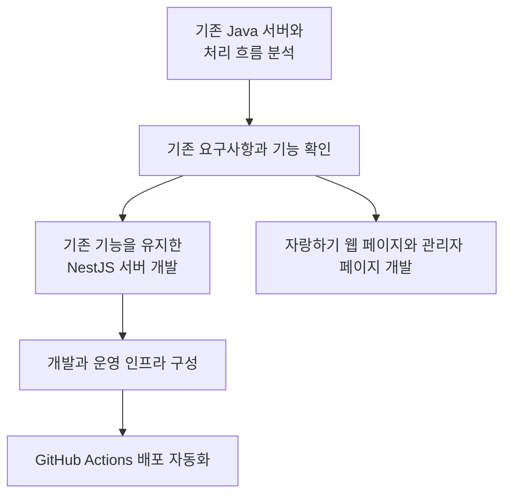
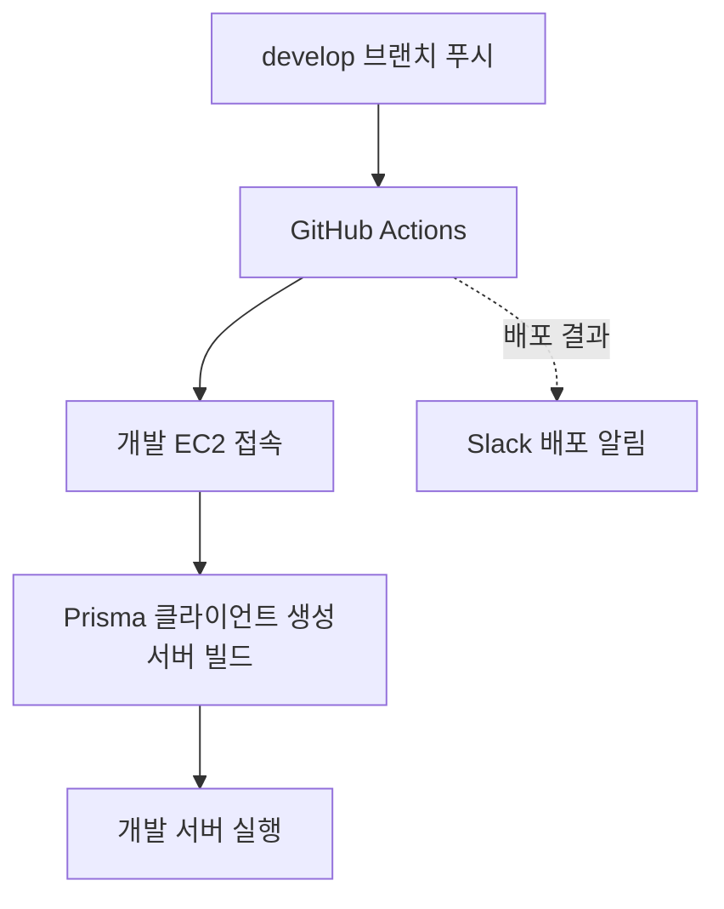
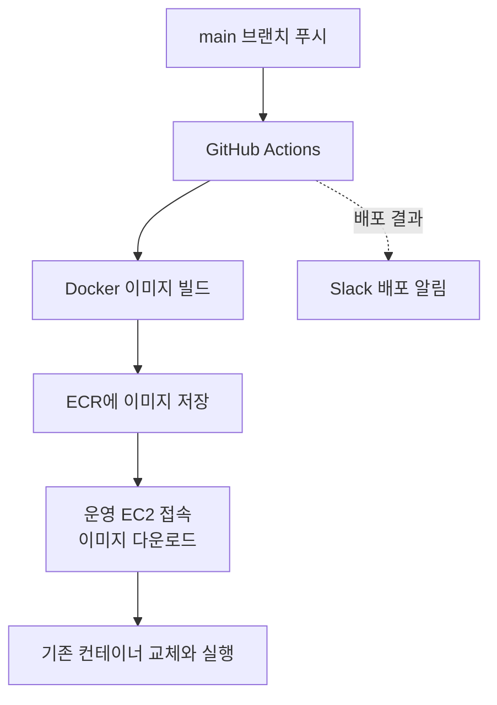

# 계열사 연동 서비스 서버 재구성과 관리자 페이지 개발

[교육 서비스 작업 목록](README.md)으로 돌아갑니다.

계열사 교육 플랫폼에 APK로 연동되는 서비스의 Java 서버를 분석하고, 기존 기능을 유지하며 NestJS로 재구성했습니다. 인프라 구성과 배포 자동화, 자랑하기 웹 페이지와 관리자 페이지 개발도 맡았습니다.

## 기본 정보

| 항목 | 내용 |
| --- | --- |
| 작업 기간 | 2024-01 ~ 2025-10 근무 중 진행 |
| 맡은 범위 | 기존 서버 분석과 재구성, 인프라와 배포 자동화, 자랑하기 웹과 관리자 페이지 개발 |
| 개발 상태 | 개발 완료 |
| 운영 상태 | 재직 당시 운영 반영 |

## 배경과 과제

기존 Java 서버의 기능을 유지하면서 구조를 정리하고, 새로운 개발, 배포 환경으로 전환해야 했습니다. 이를 위해 기존 코드와 처리 흐름을 짧은 일정 안에 파악하는 것이 우선이었습니다.

## 역할 분담

| 담당 역할 | 맡은 일 |
| --- | --- |
| 본인 | 인프라 구성, 서버 개발, GitHub Actions와 ECR을 이용한 배포 자동화, 자랑하기 웹 페이지와 관리자 페이지 개발 |
| 기존 클라이언트 담당자 | 클라이언트 전체 개발 |
| 클라이언트 유지보수 담당자 | 클라이언트 유지보수와 추가 개발 |

## 기술 스택

| 구분 | 기술 |
| --- | --- |
| 언어 | TypeScript |
| 프론트엔드 | Next.js, Tailwind CSS, TanStack |
| 백엔드 | NestJS, Zod, Prisma |
| 데이터베이스 | MySQL |
| 인프라와 배포 | GitHub Actions, EC2, ECR, Docker |
| 배포 알림 | Slack |

TanStack은 관리자 페이지에 사용했습니다.

## 어떻게 해결했는지

### 기존 서버 분석과 재구성

기존 Java 코드와 처리 흐름을 분석한 뒤 기능 호환성을 유지하면서 NestJS, Prisma, MySQL 기반으로 서버를 재구성했습니다.

### 자랑하기 웹 페이지와 관리자 페이지 개발

- **사용자 웹:** Next.js 기반 자랑하기 페이지
- **관리자 기능:** 화면과 API 개발, 사용자 등급별 화면 설정
- **운영 대시보드:** 그림 수량 및 유입 지표 조회

### 인프라와 배포 자동화

GitHub Actions로 개발, 운영 배포 과정을 구분했습니다.

- **개발:** `develop` 푸시 시 EC2에서 Prisma 클라이언트 생성, 서버 빌드 및 실행
- **운영:** `main` 푸시 시 Docker 이미지 빌드, ECR 등록 후 EC2 컨테이너 교체
- **결과 확인:** 성공, 실패 알림을 Slack으로 전달

## 작업 흐름

## 개발과 운영 배포 흐름

### 개발 환경 배포

### 운영 환경 배포

## 결과와 현재 상태

기존 서비스 기능을 유지하면서 Java 서버를 NestJS로 전환하고 자랑하기 웹, 관리자 기능을 함께 제공했습니다. 개발, 운영 배포 자동화와 Slack 결과 알림까지 구성해 서비스에 반영했습니다.
