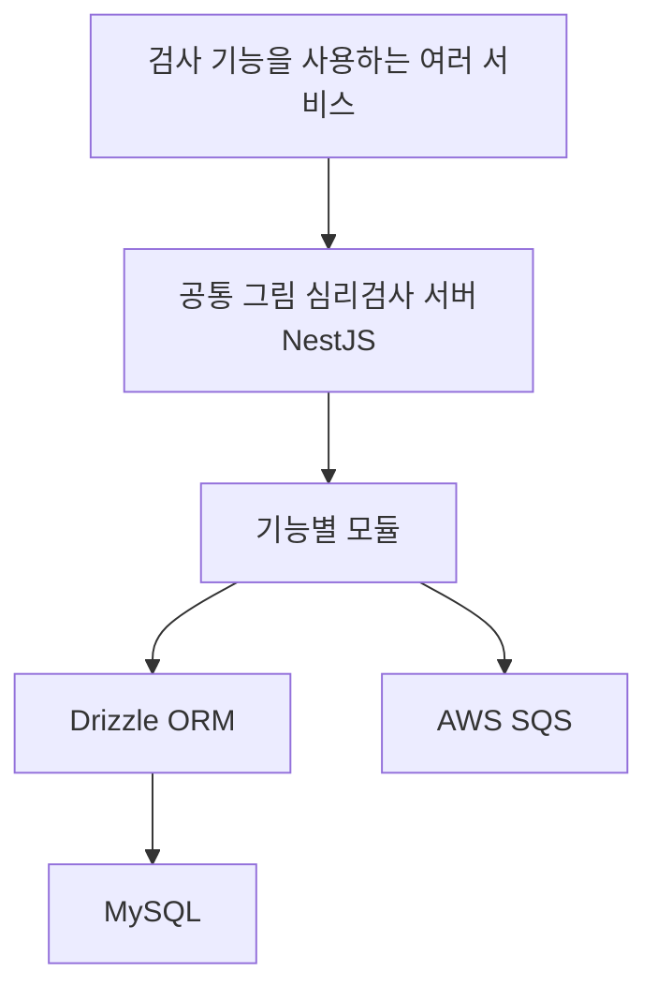

# AI 그림 심리검사 서비스 개편

[교육 서비스 작업 목록](README.md)으로 돌아갑니다.

기존 Java Spring 서버의 불필요한 코드를 정리하고 NestJS와 Drizzle 기반으로 다시 설계했습니다. 서비스마다 검사 기능을 따로 만들지 않고 공통 서버를 연동해 사용할 수 있도록 구성했습니다.

## 기본 정보

| 항목 | 내용 |
| --- | --- |
| 작업 기간 | 2025-02-25 합류 |

| 맡은 범위 | 기존 서버 분석, 공통 서버 설계와 구현, 모듈 분리, 환경 설정과 배포 구성 |
| 개발 상태 | 개발 완료 |
| 운영 상태 | 2025-03-06 운영 반영(재직 당시) |

개발 서버 배포: 2025-03-04.

## 왜 시작했는지

- 기존 Java Spring 서버는 기능 범위가 제한되어 새 요구사항을 반영하기 어려웠다.
- 불필요한 코드를 줄이고, 여러 서비스가 같은 검사 기능을 사용할 수 있게 구조를 바꿀 필요가 있었다.
- 짧은 일정 안에 서버를 전환하고 운영 가능한 상태로 준비해야 했습니다.

## 역할 분담

| 담당 역할 | 맡은 일 |
| --- | --- |
| 본인 | 기존 서버 분석, 시스템 설계와 구현, 기능별 모듈 분리, 환경 설정과 배포 구성 정리 |
| 인프라 담당자 | 인프라 설계와 구성 검토 |

## 기술 스택

| 구분 | 기술 |
| --- | --- |
| 언어 | TypeScript |
| 백엔드 | NestJS, Drizzle ORM |
| 데이터베이스 | MySQL |
| 외부 연동 | AWS SDK v3 |
| 메시지 처리 | AWS SQS |

## 어떻게 해결했는지

- **서버 전환:** 기존 Java Spring 코드를 분석하고 필요한 기능을 NestJS, Drizzle 기반으로 재구성
- **공통 모듈:** 여러 서비스에서 연동할 수 있도록 검사 기능을 업무별로 분리
- **검사 데이터:** 검사 유형별 질문 묶음, 내용, 순서 및 선택지 관리
- **배포 및 비동기 작업:** 환경별 설정, 배포 구성 정리와 별도 처리 작업의 SQS 연계

## 서버 구성

## 결과와 현재 상태

기존 검사 기능을 NestJS, Drizzle 공통 서버로 전환해 서비스별 중복 구현을 줄일 수 있는 구조를 2025년 3월 6일 운영에 반영했습니다.
