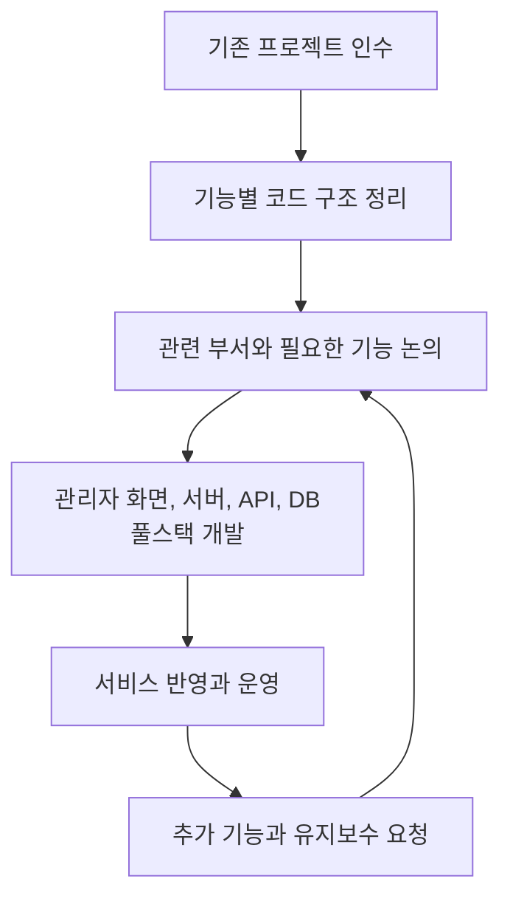

# 개인 고객 서비스 관리자 페이지

[교육 서비스 작업 목록](README.md)으로 돌아갑니다.

기존 관리자 프로젝트를 인수해 기능별 구조를 정리하고, 관련 부서와 요구사항을 협의하며 화면·API·DB를 개발했습니다. 2025년 10월까지 운영 기능 추가와 유지보수를 담당했습니다.

## 기본 정보

| 항목 | 내용 |
| --- | --- |
| 작업 기간 | 프로젝트 인수 후 2025-10까지 개발과 유지보수 |
| 맡은 범위 | 관리자 화면, 서버, API와 DB 풀스택 개발 및 유지보수 |
| 개발 상태 | 2025-10까지 개발과 유지보수 완료 |
| 운영 상태 | 재직 당시 운영 반영 |

## 왜 시작했는지

- 기존 담당자가 퇴사한 뒤 유지보수와 구조 안정성 개선이 필요한 프로젝트를 인수했습니다.
- 운영에 필요한 기능이 체계적으로 정리되어 있지 않았다.

## 역할 분담

- **본인:** 프로젝트 인수 및 구조 개선 주도, 관리자 화면·서버·API·DB 풀스택 개발과 유지보수
- **관련 부서:** 운영에 필요한 기능과 업무 흐름 협의

## 기술 스택

| 구분 | 기술 |
| --- | --- |
| 언어 | TypeScript |
| 프론트엔드 | React, Refine, MUI Pro |
| 백엔드 | NestJS, Prisma |
| 데이터베이스 | MySQL |

## 어떻게 해결했는지

인수한 코드를 기능별로 나누고 관련 부서와 운영 요구사항을 구체화했습니다.

- **관리자 기능:** 수업 관리, 출석, 사용자 등급 분류 화면과 API 개발
- **서버·DB:** 관리자 API 설계와 데이터 구조 관리
- **운영:** 기능 배포 및 2025년 10월까지 추가 개발·유지보수

## 작업 흐름

## 결과와 현재 상태

인수한 관리자 시스템의 주요 기능을 정리하고 수업·출석·사용자 등급 관리 기능을 운영에 반영했습니다. 2025년 10월까지 추가 개발과 유지보수를 담당했습니다.
