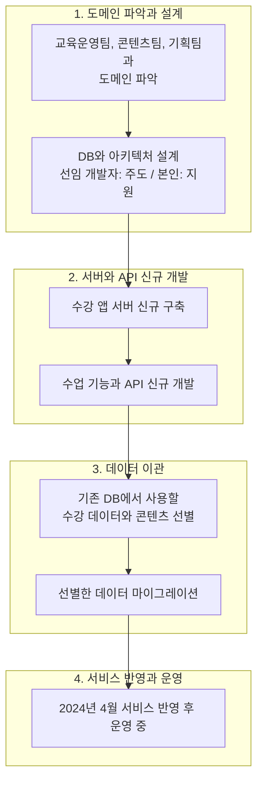

# 개인 고객 수강 앱 서버

[교육 서비스 작업 목록](README.md)으로 돌아갑니다.

기존 코드가 없는 상태에서 수강 앱 서버를 새로 개발했습니다. 기존 DB의 수강 데이터와 콘텐츠 중 사용 가능한 데이터를 골라 마이그레이션했습니다.

## 기본 정보

| 항목 | 내용 |
| --- | --- |
| 작업 기간 | 2024-01 ~ 2024-04 |
| 맡은 범위 | DB와 아키텍처 설계 지원, 서버 신규 개발, 수강 데이터와 콘텐츠 마이그레이션 |
| 개발 상태 | 개발 완료 |
| 운영 상태 | 2024-04 운영 반영(재직 당시) |

## 배경과 과제

새 수강 앱 서버가 구축되지 않아 아키텍처를 정리하고 업무 API를 신규 개발해야 했습니다. 기존 수강 데이터와 콘텐츠 가운데 새 서비스에 필요한 항목을 선별해 이전하는 작업도 필요했습니다.

## 역할 분담

| 담당 역할 | 맡은 일 |
| --- | --- |
| 본인 | 관련 부서와 도메인 파악, DB와 아키텍처 설계 지원, 서버와 API 신규 개발, 사용 가능한 수강 데이터와 콘텐츠 선별 및 마이그레이션 |
| 선임 개발자 | DB와 아키텍처 설계 주도 |
| 교육운영팀, 콘텐츠팀, 기획팀 | 서비스 도메인과 업무 흐름을 함께 논의 |

## 기술 스택

| 구분 | 기술 |
| --- | --- |
| 언어 | TypeScript |
| 백엔드 | NestJS, Prisma |
| 데이터베이스 | MySQL |

## 어떻게 해결했는지

교육운영팀, 콘텐츠팀, 기획팀과 수강 업무 흐름을 정리하고, 선임 개발자가 주도한 DB, 아키텍처 설계를 지원했습니다.

- **서버 신규 개발:** 1:1 수업 예약, 입장, 종료 및 출결 관리 API 구현
- **데이터 이전:** 기존 DB의 수강 데이터와 콘텐츠를 선별해 신규 환경으로 마이그레이션

## 작업 흐름

## 결과와 현재 상태

기존 서버가 없는 상태에서 신규 수강 앱 API와 데이터 이전 작업을 완료하고 2024년 4월 서비스에 반영했습니다. DB, 아키텍처의 설계 주도는 선임 개발자가, 서버 구현과 데이터 이전은 본인이 맡았습니다.
