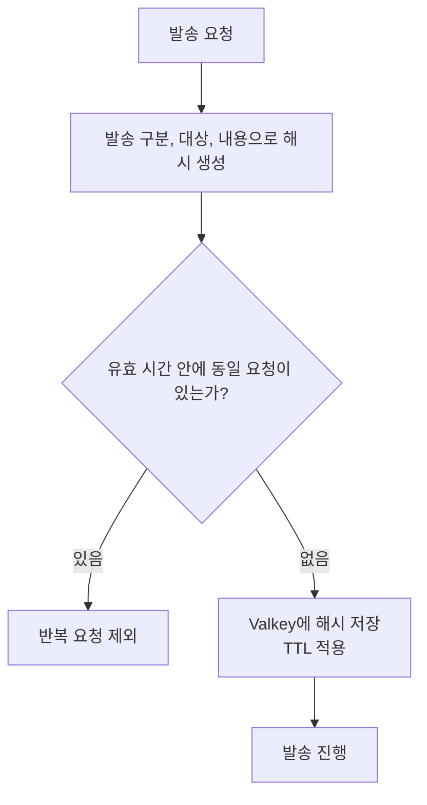
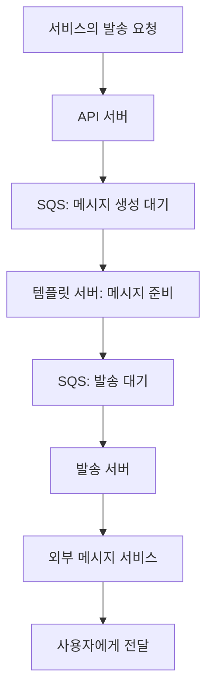
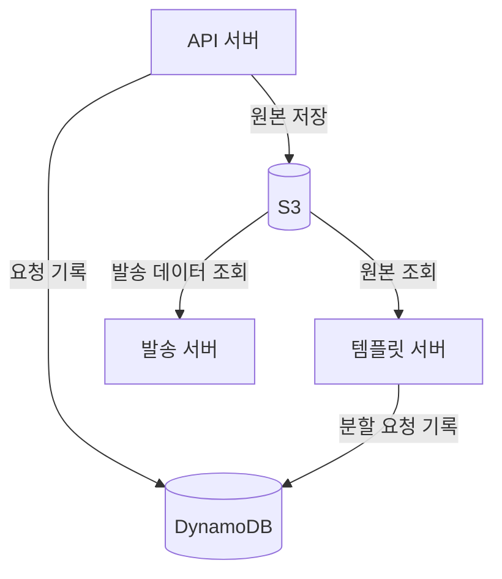
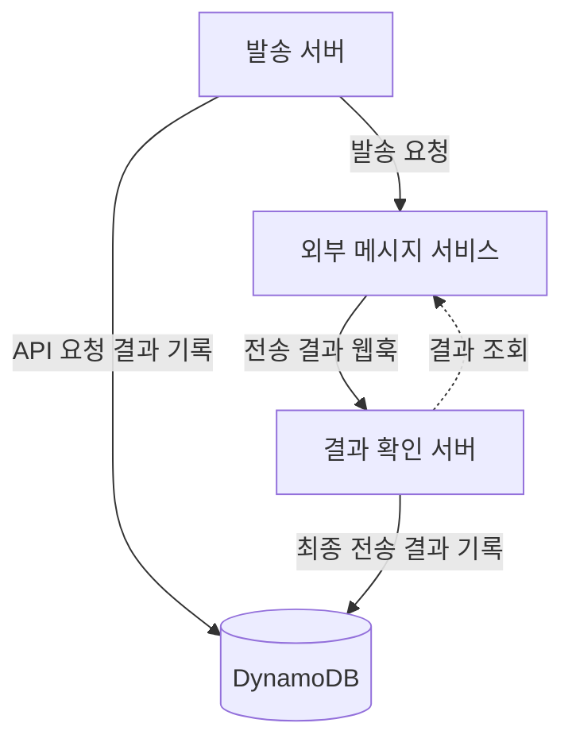

# 통합 알림 시스템

[교육 서비스 작업 목록](README.md)으로 돌아갑니다.

서비스별로 분산된 알림 발송 기능을 공통 시스템으로 통합했습니다. 요청 접수부터 최종 전송 결과까지 단계별 이력을 기록하고, 대량 발송과 중복 요청을 처리하도록 구성했습니다.

## 기본 정보

| 항목 | 내용 |
| --- | --- |
| 작업 기간 | 2025-02 운영 배포 진행 |
| 맡은 범위 | 기술 선택과 구조 설계, 공통 알림 구현, 배포 자동화 |
| 개발 상태 | 개발 완료 |
| 운영 상태 | 2025-03-01 운영 반영(재직 당시) |

개발 서버 배포: 2025-02-19.

## 왜 시작했는지

서비스별 알림 서버가 분리돼 기능 확장과 발송 이력 추적이 어려웠습니다. 대량 발송과 장애 후 재처리도 필요했으며, 개발 일정과 구성 복잡도를 고려해 Kafka 대신 SQS를 선택했습니다.

## 역할 분담

| 담당 역할 | 맡은 일 |
| --- | --- |
| 본인 | 기술 선택과 시스템 구조 설계, 공통 알림 기능 구현, GitHub Actions 배포 자동화 |
| 인프라 담당자 | 인프라 설계와 구성 검토 |

## 기술 스택

| 구분 | 기술 |
| --- | --- |
| 언어 | TypeScript |
| 백엔드 | NestJS, NestJS Workspaces |
| 메시지 처리 | AWS SQS |
| 데이터베이스 | DynamoDB |
| 스토리지 | AWS S3 |
| 중복 요청 검사 | Valkey |
| 발송 채널 | Biztalk, Twilio SendGrid |
| 인프라와 배포 | GitHub Actions, ECR, ECS, Fargate |

## 템플릿을 사용한 이유

호출 서비스마다 메시지 내용을 직접 작성하지 않도록 업무 구분 코드에 이메일·문자·알림톡 템플릿을 연결했습니다.

- **템플릿:** 제목, 본문, 필요한 변수와 사용 여부 정의
- **호출 계약:** 서비스가 사용자 이름·인증값 등 필요한 데이터를 전달하면 알림 시스템에서 메시지 준비

쿠폰 안내는 공통 문구에 이름, 쿠폰명, 코드, 등록 기한을 적용한 사례입니다. 다만 기존 구현에는 템플릿 변경 시 호출 서버나 클라이언트를 다시 배포해야 하는 제한이 있었습니다.

## DynamoDB를 선택한 이유

| 고려한 조건 | 선택 이유 |
| --- | --- |
| 발송 로그는 추가 저장이 많고 수정이 적음 | 로그를 계속 쌓고 요청별 이력을 찾는 용도에 맞춰 검토 |
| 발송량이 시간대에 따라 달라짐 | 요청 증가에 대응하면서 서버 관리 부담을 줄이려는 목적 |
| 서비스와 메시지별 이력 조회 | PK와 SK로 조회 대상을 정하고, 추가 조회에는 GSI 사용 |
| 로그 보관 기간 관리 | 일정 기간 후 자동 삭제하는 TTL 기능을 고려 |
| 비용과 운영 관리 | MongoDB의 시간 순서 데이터 구조와 비교한 뒤 DynamoDB 선택 |

## Valkey를 선택한 이유

Valkey를 반복 발송 요청 검사에 사용해 TTL이 지나면 필터 키가 만료되도록 했습니다. 선택 시 오픈소스 사용과 운영 비용을 함께 고려했습니다.

AWS 인프라 비용은 별도입니다. ElastiCache는 Redis OSS 대비 Valkey의 서버리스 가격을 33%, 노드형 가격을 20% 낮게 안내합니다. [AWS 요금 안내](https://aws.amazon.com/elasticache/pricing/)

## 반복 발송 요청 필터링

### 적용 정책

발송 구분·대상·템플릿 기반 내용을 조합해 해시를 만들고 Valkey에 TTL과 함께 저장했습니다. 유효 시간 안의 동일 요청은 제외하며, 키 만료 후에는 다시 처리할 수 있습니다.



### 권장 명령 예시

```text
SET notification:dedup:<hash> <request-token> NX EX <ttl-seconds>
```

- **`NX`:** 키가 없을 때만 저장해 동일 요청 중 먼저 저장한 요청만 통과
- **`EX`:** 유효 시간을 초 단위로 지정
- **반환값:** `OK`이면 발송하고, 기존 키가 있어 `nil`이면 반복 요청으로 제외

조회·저장·TTL 설정을 별도 단계로 나누지 않고 한 명령으로 처리합니다. [Valkey SET 문서](https://valkey.io/commands/set/)

발송 후에도 TTL 만료까지 키를 유지합니다. 재시도 전 발송 결과를 확인하고, 외부 결과가 불명확하면 키를 지워 즉시 재발송하지 않습니다. TTL 필터는 일정 시간의 반복 요청을 제한하는 용도이며 실제 발송 이력은 별도로 관리합니다.

## 어떻게 해결했는지

### 발송 단계 분리

- **API 서버:** 발송 요청 접수 및 대량 발송 데이터 S3 저장
- **템플릿 서버:** SQS 작업 수신, 발송 데이터 조회와 메시지 준비
- **발송 서버:** 별도 SQS에서 작업을 받아 외부 메시지 서비스 호출
- **결과 확인 서버:** 외부 전송 결과 수신 및 DynamoDB 기록

최초 요청, 분할 요청, 발송 API 응답과 최종 전송 결과를 단계별로 나눠 추적하도록 구성했습니다.

### 데이터 구조와 장애 대응

- **데이터 모델:** DynamoDB PK·SK를 이용해 서비스 정보, 템플릿, 푸시 토큰 및 이벤트 로그 구분
- **추적:** 발송 상태, 오류, 요청·응답을 기록해 단계별 문제 확인
- **실패 대응:** 큐 등록 실패·서버 장애 시 재처리할 요청 보관, 공통 예외와 SQS DLQ 처리 분리
- **결과 매핑:** Biztalk 웹훅 결과를 원래 사용자·메시지와 연결할 수 있도록 GSI 조회 적용

### 개발 API 배포 자동화

개발 API용 태그를 트리거로 GitHub Actions에서 Docker 이미지를 빌드하고 ECR에 게시한 뒤 ECS 실행 설정을 갱신하도록 했습니다. 배포 후에는 서비스가 안정 상태에 도달했는지 확인하는 단계를 연결했습니다.

## 시스템 구조와 발송 흐름

### 요청부터 발송까지



### 요청과 메시지 준비 기록



### 외부 발송과 전송 결과 기록



요청 기록·대량 데이터 저장과 외부 발송·결과 기록을 두 그림으로 구분했습니다. 발송 서버와 DynamoDB는 공통 구성요소이며, 결과 확인 서버는 외부 발송 API 응답과 최종 전송 결과를 별도로 기록하는 내부 서버입니다.

실선은 요청·조회·저장·결과 전달을, 점선은 결과 확인 서버의 외부 결과 조회를 뜻합니다. 구성요소 간 관계를 표현한 것으로 엄격한 실행 순서는 아닙니다.

## 결과와 현재 상태

서비스별로 흩어져 있던 알림 발송을 공통 경로로 통합해 2025년 3월 1일 운영에 반영했습니다.

- **대량 발송:** S3·SQS를 통한 비동기 메시지 처리
- **추적:** 최초 요청부터 최종 전송 결과까지 단계별 이력 조회, 웹훅 결과 매핑
- **중복 제한:** 발송 구분·대상·내용 해시와 Valkey TTL을 이용한 일정 시간 내 반복 요청 필터링
