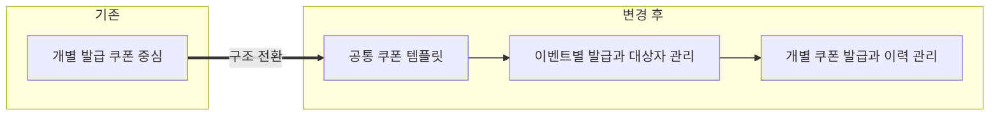
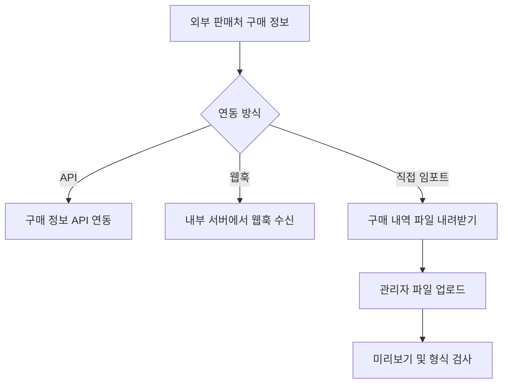
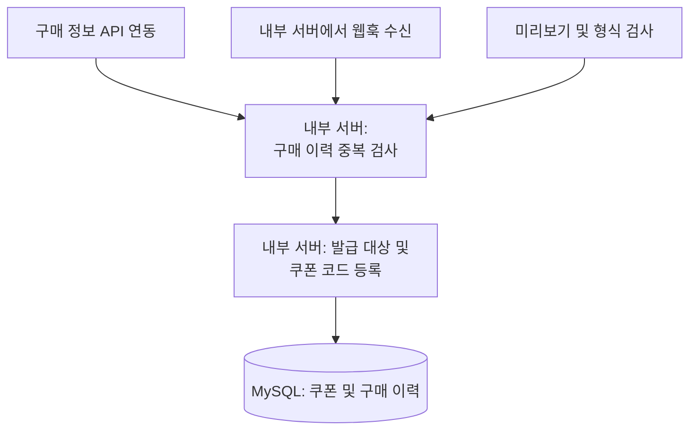
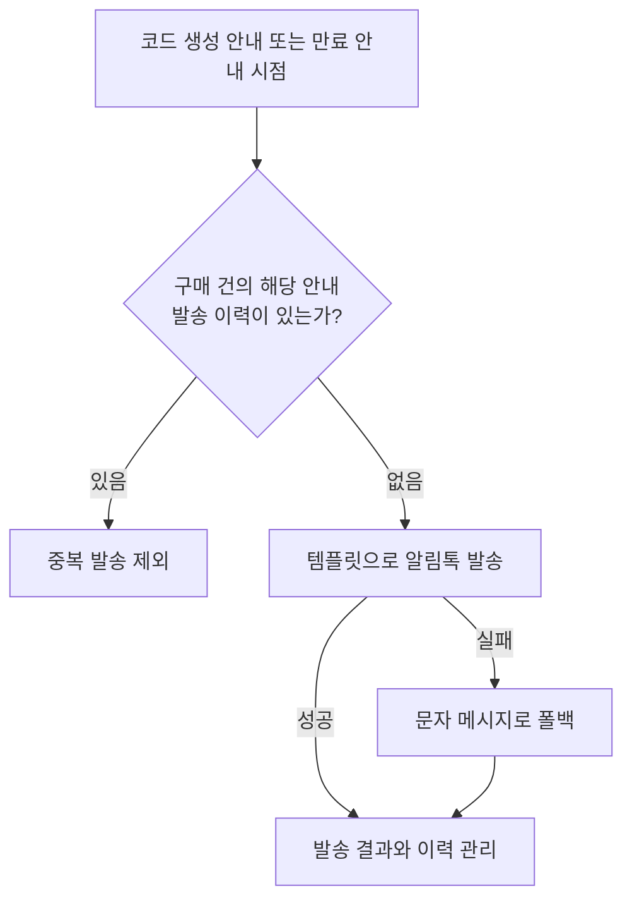
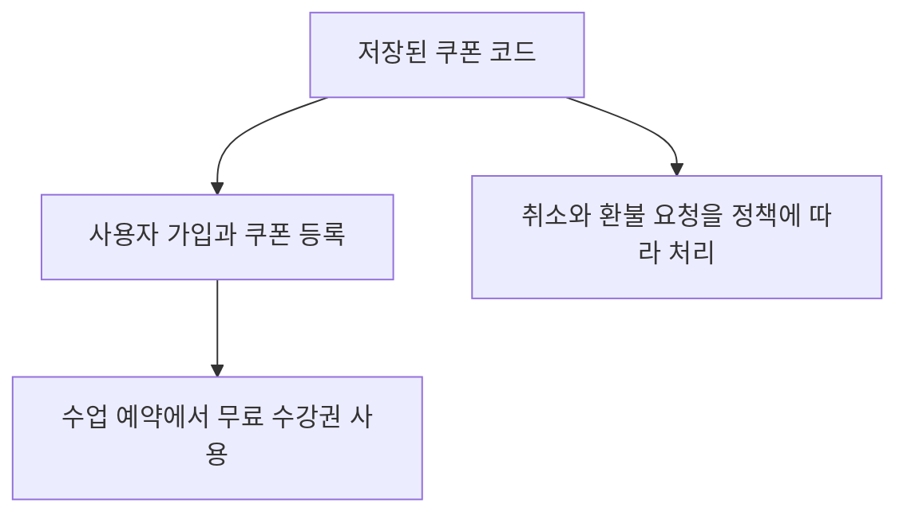

# 쿠폰 이벤트 시스템

[교육 서비스 작업 목록](README.md)으로 돌아갑니다.

여러 외부 판매처의 구매 정보를 내부 시스템으로 모아 쿠폰을 발급하고 관리하도록 만들었습니다. 개별 쿠폰 중심의 구조를 템플릿과 이벤트 기반으로 바꾸고, 관리자 풀스택 개발과 서버, DB 설계를 맡았습니다.

## 기본 정보

| 항목 | 내용 |
| --- | --- |
| 작업 기간 | 제휴 연계 2025-06-02 시작 |
| 맡은 범위 | 쿠폰 템플릿과 이벤트 DB 설계, 서버와 API 개발, 관리자 풀스택 개발 |
| 개발 상태 | 개발 완료 |
| 운영 상태 | 2025-07-28 운영 반영(재직 당시) |

개발 서버 배포: 2025-06-13.

## 배경과 과제

개별 쿠폰 인스턴스 중심 구조에서는 만료 정책과 발급 대상, 이력, 메시지 발송을 이벤트마다 따로 관리해야 했습니다. 공통 정책을 재사용하기 어려운 데다 제휴사에서 결제한 사용자에게 무료 수강권을 제공하는 연결 방식도 필요했습니다.

판매처마다 연동 조건이 달라 API 연동, 웹훅 수신, 파일 임포트를 모두 지원하는 구조를 목표로 했습니다.

## 역할 분담

| 담당 역할 | 맡은 일 |
| --- | --- |
| 본인 | 쿠폰 템플릿과 이벤트 기반 DB 설계, 쿠폰 서버와 API 개발, 관리자 화면과 서버를 포함한 풀스택 개발 |
| 프론트엔드 담당자 | 사용자용 서비스의 쿠폰 입력, 등록과 사용 화면 개발 |
| 외부 판매처 | 결제 처리와 구매 정보 제공 |

관리자에는 파일 업로드, 미리보기, 오류 검사, 개별, 일괄 등록, 목록 조회 및 삭제 기능을 개발했습니다.

## 기술 스택

| 구분 | 기술 |
| --- | --- |
| 언어 | TypeScript |
| 프론트엔드 | React, Tailwind CSS, Refine, MUI Pro |
| 백엔드 | NestJS, Prisma, Zod |
| 데이터베이스 | MySQL |
| 메시지 발송 | Biztalk, Twilio |
| 파일 처리 | xlsx, CSV 처리 모듈 |

Refine, MUI Pro, Zod와 파일 처리 모듈은 제휴 쿠폰 연계 작업에 사용했습니다.

## 어떻게 해결했는지

### 개별 쿠폰 중심에서 템플릿과 이벤트 기반으로 전환

- **템플릿:** 기존 쿠폰 인스턴스 위에 공통 만료, 발급 정책을 관리하는 상위 기준 도입
- **이벤트:** 템플릿과 발급 대상 및 이벤트별 쿠폰 발급 흐름 연결
- **발급 이력:** 공통 정책과 개별 발급 기록을 분리해 다른 이벤트에서도 같은 구조를 재사용

### 쿠폰 정책과 운영 기능

- **정책:** 인증일, 발급일 기준 만료일 산정과 취소, 환불 규칙 적용
- **관리 기능:** 발급 이력 검색, 필터링, 다운로드 제공
- **알림 연계:** 쿠폰 상태 변경에 따른 안내 발송 연결

### 판매처 연동과 구매 정보 등록

- **판매처 입력:** 구매 정보 API 조회, 웹훅 수신, 관리자 수동 임포트(xlsx, csv) 지원
- **등록 검증:** 파일 미리보기, 형식, 중복 검사 후 개별 및 일괄 등록; 목록 조회, 개별 삭제 API 제공
- **이력 모델:** 쿠폰 코드, 수신 대상 식별값, 연결 쿠폰, 만료일, 사용일, 마지막 발송 시각 저장
- **코드 규칙:** 영문 대문자와 숫자를 조합한 8자리 코드 사용(숫자 0 제외)

### 쿠폰 안내와 사용

- **발송 시점:** 만료 안내 시점 설정(기본 3일 전, 1일 전) 및 코드 생성 안내
- **발송 채널:** 알림톡 우선, 실패 시 문자 폴백
- **메시지 템플릿:** 이름, 쿠폰명, 코드, 등록 기한을 변수로 사용

사용자는 안내 링크를 통해 가입, 쿠폰 등록 후 수업 예약에 무료 수강권을 적용하는 흐름입니다.

## 중복 검사와 발송 이력

| 처리 방식 | 적용 범위 |
| --- | --- |
| 구매 이력 ID 기반 필터링 | 같은 구매 이력이 반복 유입될 때 중복 처리 방지 |
| 파일 형식 검사 | 임포트할 구매 정보의 형식 확인 |
| 쿠폰 코드의 DB 고유 제약 | 같은 쿠폰 코드가 두 번 저장되지 않도록 구성 |
| 수신 대상 식별값과 만료일에 조회용 인덱스 설정 | 대상자와 만료 대상 조회 |
| 구매 이력 ID와 발송 이력 확인 | 같은 구매 건에서 해당 안내 단계가 이미 발송됐는지 확인해 중복 발송 방지 |
| 마지막 발송 시각 저장 | 발송 이력 관리 |

## 제휴 쿠폰 처리 흐름

### 구매 정보 등록

#### 판매처 입력 경로

#### 중복 검사와 DB 등록

API 연동, 웹훅 수신, 파일 임포트에서 전달된 데이터는 공통 중복 검사와 등록 경로로 이어집니다.

구매 정보는 판매처 API, 웹훅 또는 관리자 파일 임포트로 받고 내부 서버에서 검증 후 등록합니다. 쿠폰 템플릿과 이벤트 정책도 같은 서버와 DB에서 관리하며 별도의 쿠폰 발급 엔진을 두었다는 의미는 아닙니다.

### 쿠폰 안내와 발송 이력

### 쿠폰 사용과 취소 정책

구매 정보 등록 이후 안내 발송, 쿠폰 사용과 취소 정책은 각각 독립된 흐름으로 표시했습니다.

## 결과와 현재 상태

개별 쿠폰 중심 구조를 템플릿과 이벤트 기반으로 전환해 공통 정책과 발급 이력을 분리했습니다. 여러 판매처의 구매 정보 등록부터 쿠폰 발급, 알림까지 관리자 시스템에서 처리하도록 통합했으며, 2025년 7월 28일 운영에 반영했습니다.

- **운영 범위:** API, 웹훅, 파일 임포트, 취소, 환불 정책, 안내 시점 설정
- **발송 안정성:** 알림톡 실패 시 문자 폴백과 발송 이력 기반 중복 방지
