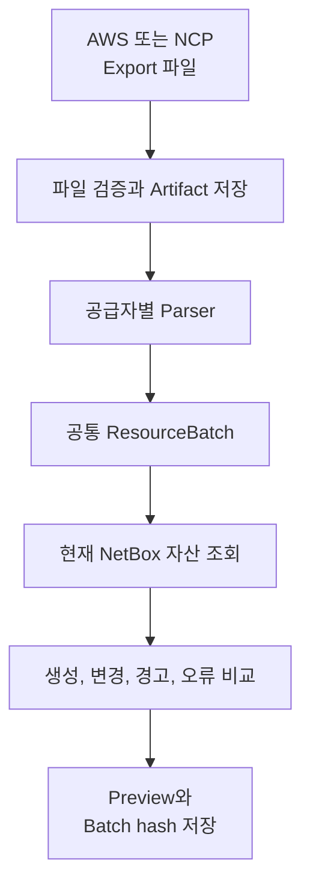
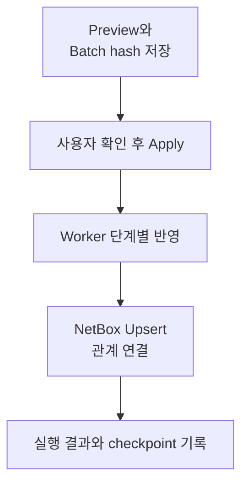

# NetBox Cloud Inventory 멀티클라우드 인프라 자산 관리 PoC 개발

[프로젝트 개요](README.md)로 돌아갑니다.

여러 AWS와 NAVER Cloud Platform 계정에 흩어진 인프라 자산을 한곳에서 조회하고 관계를 추적할 수 있도록 NetBox를 중앙 인프라 장부로 사용하는 PoC를 만들었습니다.
현재 구현은 클라우드 API 자동 수집 전 단계로, 실제 콘솔 Export 파일을 안전하게 업로드하고 변경 내용을 확인한 뒤 NetBox에 반영하는 수동 Import 흐름에 집중했습니다.

[코드 저장소](https://github.com/KimHG1995/netbox-cloud-inventory)

## 기본 정보

| 항목 | 내용 |
| --- | --- |
| 작업 기간 | 2026-07 |
| 맡은 범위 | 자산 모델과 동기화 정책 설계, FastAPI Import UI와 API, 파일 파서, PostgreSQL 작업 큐, NetBox 스키마와 반영 로직, 테스트와 로컬 통합 환경 |
| 개발 상태 | 수동 Import PoC 개발 완료 |
| 운영 상태 | 합성 데이터와 테스트 계정 기준 로컬 통합 검증 완료, 실제 운영 계정 연동 미진행 |

## 왜 시작했는지

서로 다른 클라우드 계정의 서버·네트워크·IP·DNS·DB 관계를 공급자 콘솔에서 각각 확인해야 해 자산의 소속과 연결 관계를 추적하기 어려웠습니다. 수기 관리 문서와 실제 인프라의 상태가 달라질 위험도 있었습니다.

별도 자산 관리 UI를 만드는 대신 NetBox를 인프라 관리 기준으로 사용하고, 공급자별 Export 파일을 공통 모델로 변환하는 수집 계층에 집중했습니다.

## 기술 스택

| 구분 | 기술 |
| --- | --- |
| 언어 | Python 3.12 |
| API와 UI | FastAPI, 서버 렌더링 HTML |
| 제어 데이터베이스 | PostgreSQL, SQLAlchemy, Alembic |
| 자산 관리 | NetBox 4.6, NetBox Custom Objects |
| 파일 처리 | CSV, XLSX, JSON Schema |
| 개발 환경 | uv, Docker Compose |
| 테스트와 자동화 | pytest, GitHub Actions |

## 어떻게 해결했는지

### NetBox를 중앙 인프라 장부로 사용

NetBox에 인프라 자산과 관계를 저장하고, PostgreSQL은 Import 작업 큐·실행 상태·Preview·파일 정보 등 제어 데이터만 관리하도록 역할을 분리했습니다. 공통 자산은 NetBox 기본 모델을, 공급자별 개념은 Custom Object를 사용했습니다.

- Region과 Zone
- VPC와 Subnet
- Virtual Machine과 Network Interface
- 사설 IP와 공인 IP
- Load Balancer
- Domain과 DNS
- Managed Database
- Object Storage
- Business Service와 Owner

### 공급자별 입력을 공통 모델로 정규화

AWS와 NAVER Cloud Platform의 Export 형식이 달라도 이후 처리 로직은 같게 가져가기 위해 모든 Parser가 공통 `ResourceBatch`를 생성하도록 했습니다.

현재 수동 Import에서 지원하는 입력은 다음과 같습니다.

- AWS Resource Explorer CSV
- NAVER Cloud Platform Server 목록 XLSX
- NAVER Cloud Platform Public IP 목록 XLSX
- NAVER Cloud Platform Load Balancer 목록 XLSX
- NAVER Cloud Platform Object Storage 목록 XLSX
- 전체 관계를 표현하는 표준 JSON Import Bundle

각 리소스는 provider, realm, account ID, region, resource type과 external ID를 조합한 `cloud_uid`로 식별해 같은 데이터를 반복 업로드해도 동일 객체를 찾도록 했습니다.

### Preview 후 Apply하는 안전한 Import 흐름

업로드한 파일을 바로 NetBox에 쓰지 않고 먼저 파싱과 정규화, 현재 NetBox 데이터와의 비교를 수행해 생성, 변경, 경고와 오류를 Preview로 보여주도록 했습니다.

Preview 시점의 내용은 Batch hash로 고정하고 Apply 요청에서도 같은 hash인지 확인해 사용자가 확인한 변경 내용과 실제 반영 대상이 달라지는 것을 막았습니다.

반영 작업은 리소스 의존 순서에 따라 여러 단계로 나누고 checkpoint를 저장해 중간 실패 이후에도 이미 완료한 단계를 기준으로 다시 처리할 수 있게 했습니다.

### 기존 운영 정보와 수동 편집 보존

클라우드에서 관측한 값과 NetBox에서 운영자가 직접 관리하는 값을 구분했습니다.

- VM 상태, VPC, Subnet, IP 같은 클라우드 관측값은 수집 결과를 기준으로 갱신합니다.
- Owner, Business Service, 설명과 운영 메모처럼 사람이 보강한 정보는 Import가 덮어쓰지 않도록 했습니다.

이 방식으로 자동 수집 영역과 운영자가 관리하는 메타데이터의 책임을 분리했습니다.

### 불완전한 파일로 인한 잘못된 비활성화 방지

수동 Export는 전체 자산을 담고 있다고 보장할 수 없기 때문에 파일에서 리소스가 보이지 않는다는 이유만으로 기존 NetBox 객체를 비활성화하거나 삭제하지 않도록 했습니다.

후속 자동 Collector도 API 수집 범위가 완전하게 성공한 경우에만 미발견 여부를 판단하고, 첫 미발견은 후보 상태로 두고 연속 미발견 이후에만 inactive 처리하는 정책으로 설계했습니다.
수집기가 NetBox 객체를 최종 삭제하지 않는 것도 기본 원칙으로 정했습니다.

### 파일 업로드와 작업 처리를 API에서 분리

업로드 파일은 크기, 확장자와 실제 콘텐츠 형식을 검증하고 원본 Artifact로 별도 보관합니다.
파싱과 비교, NetBox 반영은 PostgreSQL 기반 작업 큐를 통해 Worker가 처리하도록 해 HTTP 요청과 긴 처리 작업을 분리했습니다.

Worker는 파일을 Parser에 전달해 `ResourceBatch`로 만들고 현재 NetBox 상태를 읽어 Preview를 생성합니다.
Apply 단계에서는 승인된 Preview만 사용해 NetBox에 create, update 또는 unchanged 결과를 기록합니다.

### 자동 Collector를 위한 확장 지점

최종 목표는 클라우드 API 기반 자동 수집이지만 PoC에서는 먼저 실제 Export 파일을 이용한 수동 수집과 조회 가치를 검증했습니다.

File Parser와 향후 API Collector가 같은 `ResourceBatch`를 출력하도록 경계를 잡아 AWS나 NAVER Cloud Platform API Collector를 추가해도 정규화, 비교와 NetBox 반영 코드는 재사용할 수 있게 설계했습니다.
현재 저장소에는 AWS와 NAVER Cloud Platform API Collector는 아직 구현하지 않았습니다.

## 처리 흐름

### 파일 수집과 Preview 생성

### 승인 후 Apply와 결과 기록

사용자가 첫 그림에서 생성된 Preview와 Batch hash를 확인한 뒤 Apply로 진행합니다. 두 그림의 Preview는 같은 검토 결과입니다.

## 결과와 현재 상태

- **구현 범위:** AWS CSV·NCP XLSX·표준 JSON Bundle을 공통 모델로 변환하는 NetBox 수동 Import PoC
- **안전한 반영:** Preview·Batch hash 승인, 반복 업로드 및 Apply 멱등성, 수동 메타데이터 보존과 불완전한 Export의 자동 삭제 방지
- **검증:** 합성 Fixture·테스트 계정의 Docker Compose 통합 흐름과 GitHub Actions 기본 품질 검사
- **남은 범위:** 클라우드 API 자동 Collector, 실제 운영 계정 연결, SSO·Secret Manager 연동. 운영 계정 자동 수집은 구현하지 않음
