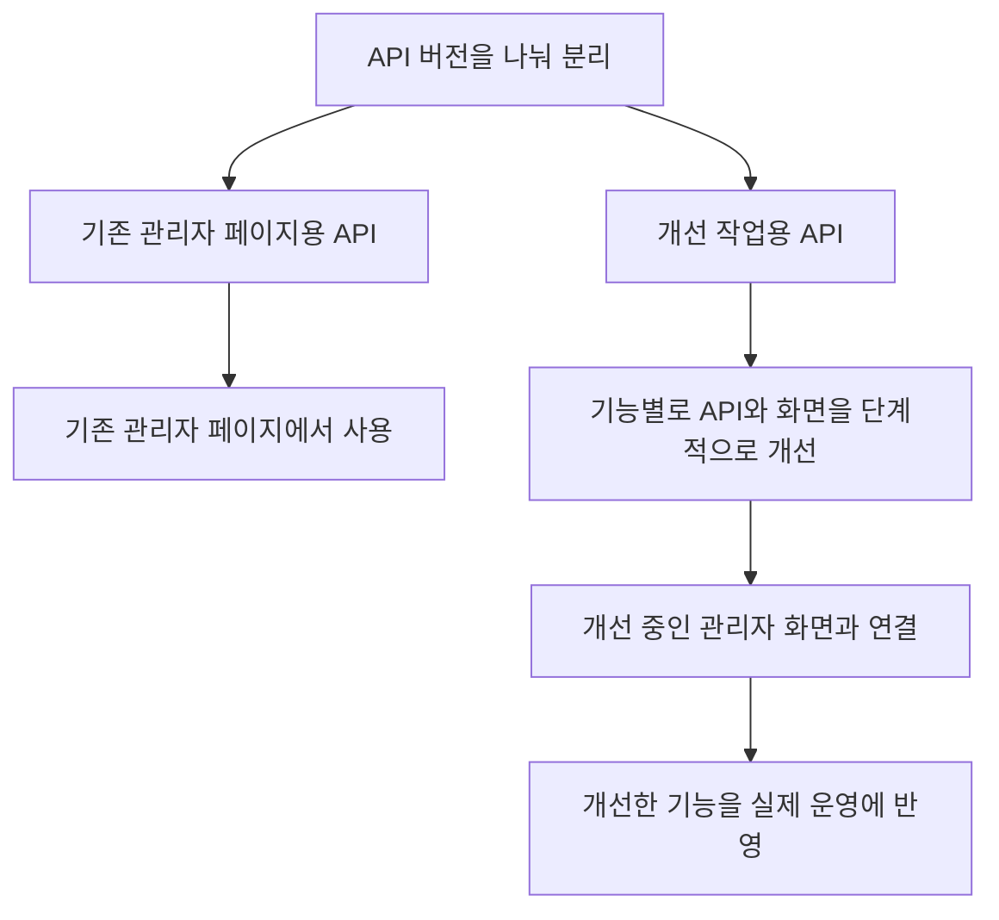

# 관리자 화면과 API 개선

[플랫폼 작업 목록](README.md)으로 돌아갑니다.

## 기본 정보

| 항목 | 내용 |
| --- | --- |
| 작업 기간 | 2021-07 ~ 2024-01 근무 중 진행 |
| 맡은 범위 | 인터널팀 리드, 기획, API 수정과 구조 전환 지원 |
| 개발 상태 | 개발 완료 |
| 운영 상태 | 재직 당시 운영 반영 |

## 왜 시작했는지

기존 Vue.js 관리자 화면은 공통 UI와 서버 호출 방식이 정리되지 않아 기능 추가와 수정이 어려웠습니다. 화면과 API를 한 번에 교체하기보다 기능별로 전환할 필요가 있었습니다.

## 역할 분담

- **본인:** 인터널팀 리드로 디자이너와 기획 협의, 기존 동작 설명, API 수정 및 단계별 전환 지원
- **프론트엔드 담당자:** React, TypeScript 기반 관리자 화면 개선

## 기술 스택

| 구분 | 기술 |
| --- | --- |
| 프론트엔드 | React, TypeScript |
| API | REST API |

프로젝트에서 사용한 기술입니다. 화면 개선은 프론트엔드 담당자가 맡았습니다.

## 어떻게 해결했는지

- **화면 전환(팀):** 관리자 웹을 React, TypeScript 기반으로 변경하고 공통 UI, API 호출 구조 정리
- **API 전환(본인):** 기존 버전과 개선 버전을 분리하고 필요한 API를 수정해 기능별 순차 적용 지원
- **운영 반영:** 개선된 기능을 단계별로 실제 서비스에 적용

## 결과와 현재 상태

기존 관리자 기능을 단계적으로 전환할 수 있도록 API 호환 경로를 분리했습니다. 화면 개발은 프론트엔드 담당자가 수행했으며, 본인은 기획과 API 수정, 전환 지원을 맡았습니다.

## API 버전을 나눈 전환 흐름

