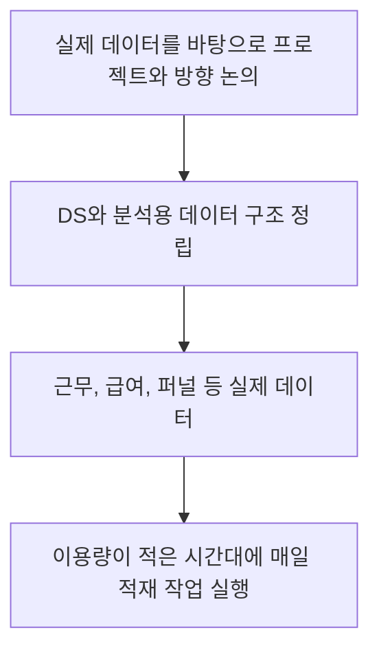
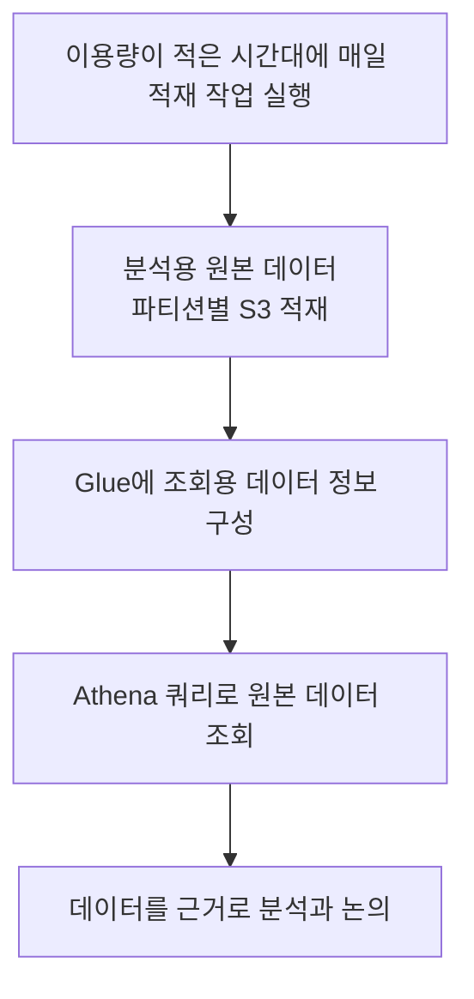
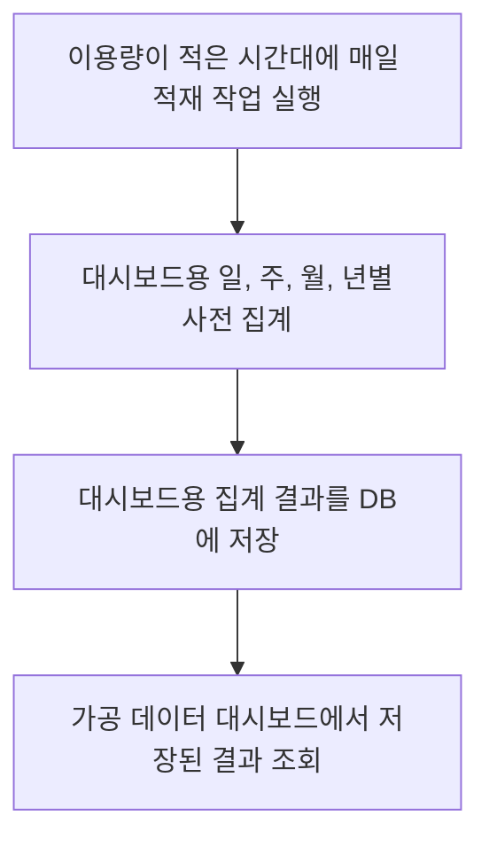

# 데이터 분석 환경과 대시보드

[플랫폼 작업 목록](README.md)으로 돌아갑니다.

## 기본 정보

| 항목 | 내용 |
| --- | --- |
| 작업 기간 | 2021-07 ~ 2024-01 근무 중 진행 |
| 맡은 범위 | DS와 데이터 구조 정리, 수집과 가공, 적재와 분석 환경 구성 |
| 개발 상태 | 개발 완료 |
| 운영 상태 | 재직 당시 운영 반영 |

## 왜 시작했는지

서비스 운영과 의사결정에 필요한 데이터를 일관되게 조회할 수 있는 분석 환경이 부족했습니다. 가공 데이터 대시보드는 조회할 때마다 집계해 서버 자원을 반복 사용하고 있었습니다.

## 역할 분담

- **DS와 협업:** 분석에 필요한 데이터 구조 협의
- **본인:** 데이터 수집·적재·가공, 파티셔닝 및 S3·Glue·Athena 환경 구성

## 기술 스택

| 구분 | 기술 |
| --- | --- |
| 스토리지 | AWS S3 |
| 데이터 분석 | AWS Glue, AWS Athena |

## 어떻게 해결했는지

- **분석 대상:** 근무·급여·사용자 퍼널 데이터
- **원본 데이터 조회:** S3 원본 적재, Glue 메타데이터 구성, Athena 쿼리 환경 제공
- **정기 적재:** 서비스 이용량이 적은 시간대에 하루 한 번 수행
- **대시보드 집계:** 조회 시 계산하던 일·주·월·연 단위 통계를 사전에 DB에 저장하고 결과만 조회하도록 변경

## 결과와 현재 상태

DS가 운영 데이터를 조회·활용할 수 있도록 S3·Glue·Athena 기반 분석 경로를 제공했습니다. 가공 데이터 대시보드는 사전 집계 방식으로 전환해 조회 시 반복 계산을 줄였고, 재직 당시 운영에 반영했습니다.

## 데이터 분석 흐름

### 분석 구조와 적재 일정

### S3 원본 적재와 조회

### 대시보드 사전 집계

첫 그림에서 원본 데이터 적재와 대시보드 사전 집계가 각각 분기됩니다. 두 조회 경로는 원본 데이터와 미리 저장된 집계 결과를 구분합니다.
