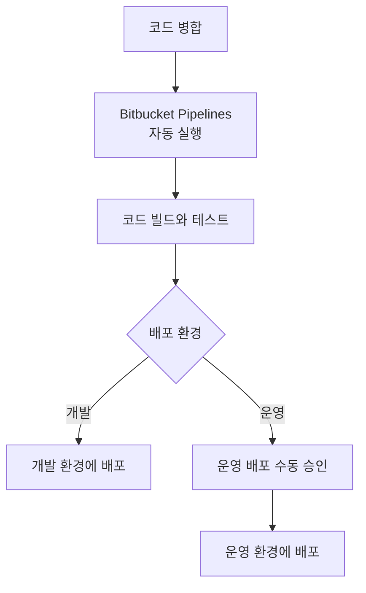

# 자동 배포

[플랫폼 작업 목록](README.md)으로 돌아갑니다.

## 기본 정보

| 항목 | 내용 |
| --- | --- |
| 작업 기간 | 2021-07 ~ 2024-01 근무 중 진행 |
| 맡은 범위 | Bitbucket Pipelines 작성 |
| 개발 상태 | 개발 완료 |
| 운영 상태 | 재직 당시 운영 반영 |

## 왜 시작했는지

기존에는 EC2에 직접 배포해 같은 절차를 반복해야 했습니다. 개발 배포는 자동화하고 운영 배포에는 승인 단계를 두는 방식으로 절차를 표준화하고자 했습니다.

## 역할 분담

- **선임 개발자:** AWS Elastic Beanstalk 환경 구성
- **본인:** 해당 환경에 배포하는 Bitbucket Pipelines 작성

## 기술 스택

| 구분 | 기술 |
| --- | --- |
| 배포 자동화 | Bitbucket Pipelines |
| 배포 환경 | AWS Elastic Beanstalk |

Elastic Beanstalk 환경은 선임 개발자가 구성했습니다.

## 어떻게 해결했는지

- **환경 분리:** 개발, 운영 각각의 배포 흐름 구성
- **자동 실행:** 코드 병합을 트리거로 빌드, 테스트 후 Elastic Beanstalk에 배포
- **승인 정책:** 개발 환경은 자동 배포, 운영 환경은 수동 승인 후 배포

## 결과와 현재 상태

배포 단계의 반복 작업을 Bitbucket Pipelines로 자동화하고 개발, 운영 환경별 실행 조건을 분리해 재직 당시 운영에 반영했습니다. Elastic Beanstalk 환경 자체는 선임 개발자가 구성했습니다.

## 배포 방식 변경

