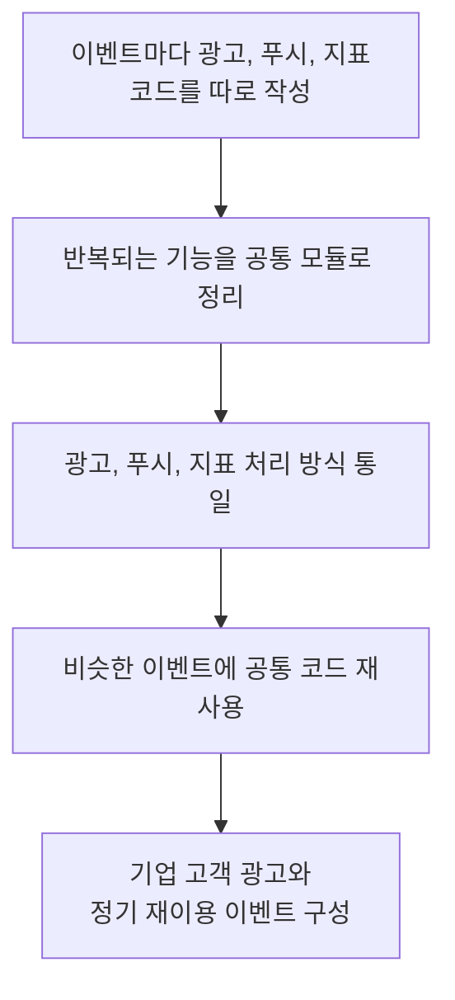
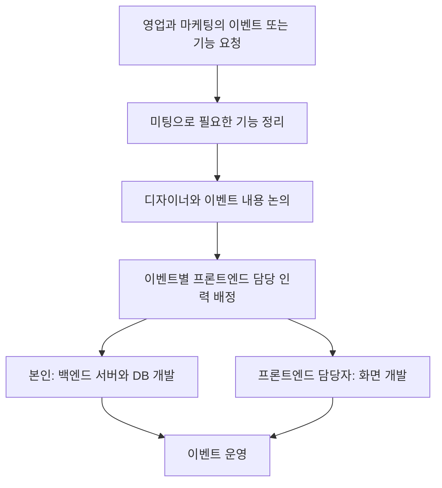

# 이벤트 공통 코드 정리

[플랫폼 작업 목록](README.md)으로 돌아갑니다.

## 기본 정보

| 항목 | 내용 |
| --- | --- |
| 작업 기간 | 2021-07 ~ 2024-01 근무 중 요청에 따라 진행 |
| 맡은 범위 | 영업과 마케팅 요청 정리, 백엔드와 DB 개발, 이벤트 공통 코드 구성 |
| 개발 상태 | 개발 완료 |
| 운영 상태 | 재직 당시 운영 반영 |

## 왜 시작했는지

기업 고객 광고와 재이용 유도 이벤트를 만들 때마다 비슷한 서버 로직을 개별 구현하고 있었습니다. 기능별 처리 방식이 달라지는 문제를 줄이고 공통 코드를 재사용할 필요가 있었습니다.

## 역할 분담

- **본인:** 영업, 마케팅, 디자인 담당자와 요구사항 협의, 이벤트 백엔드, DB 및 공통 모듈 개발
- **프론트엔드 담당자:** 각 이벤트의 사용자 화면 구현

## 기술 스택

| 구분 | 기술 |
| --- | --- |
| 백엔드 | Node.js |
| 데이터베이스 | MongoDB |
| 인프라 | AWS Lambda, AWS EventBridge |

## 어떻게 해결했는지

광고 유입과 사용자 행동 단계 확인, 푸시 발송, 지표 수집, 알림의 공통 처리 로직을 Node.js, MongoDB 기반 API로 구성했습니다. 예약 실행이 필요한 작업은 AWS Lambda와 EventBridge에 연결했습니다.

## 결과와 현재 상태

광고, 푸시, 지표 집계 및 알림 기능을 공통 모듈로 정리해 유사 이벤트에서 재사용할 수 있도록 했습니다. 해당 기능은 재직 당시 운영에 반영했습니다.

## 이벤트 코드 정리 흐름

## 이벤트별 협업 흐름

