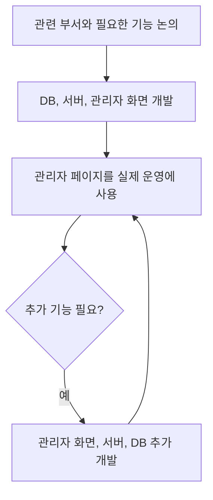

# 관리자 페이지 개발과 기능 추가

[플랫폼 작업 목록](README.md)으로 돌아갑니다.

## 기본 정보

| 항목 | 내용 |
| --- | --- |
| 작업 기간 | 2021-07 ~ 2024-01 근무 중 기능 추가 |
| 맡은 범위 | 초기 관리자 페이지 단독 개발, 이후 화면과 서버, DB 풀스택 개발 |
| 개발 상태 | 개발 완료 |
| 운영 상태 | 재직 당시 운영 반영 |

## 왜 시작했는지

기존에는 운영 요청을 처리할 때 개발자가 DB를 직접 수정해야 했습니다. 관련 부서가 반복 업무를 관리자 화면에서 직접 처리할 수 있도록 내부 도구가 필요했습니다.

## 역할 분담

- **요구사항:** 관련 부서와 필요한 관리자 기능 협의
- **초기 구축:** 사내 사이드 프로젝트로 시작해 DB·서버·관리자 화면 단독 설계 및 개발
- **확장:** 재직 기간에 추가된 운영 기능을 풀스택으로 구현

## 기술 스택

| 구분 | 기술 |
| --- | --- |
| 프론트엔드 | Vue.js, Nuxt.js |
| 백엔드 | Node.js, Express |
| 데이터베이스 | MongoDB |

## 어떻게 해결했는지

정산 요청 확인과 수기 내역 기록, 상태 변경, 사용자·인증 관리, 운영 기록 조회 기능을 관리자 시스템에 구현했습니다.

## 결과와 현재 상태

DB 직접 수정에 의존하던 운영 업무를 관리자 화면에서 처리할 수 있게 전환했습니다. 초기 구축 이후 기능을 확장해 재직 당시 실제 운영에 반영했습니다.

## 개발과 운영 흐름

관련 작업: [급여 정산과 환불](settlement.md)
