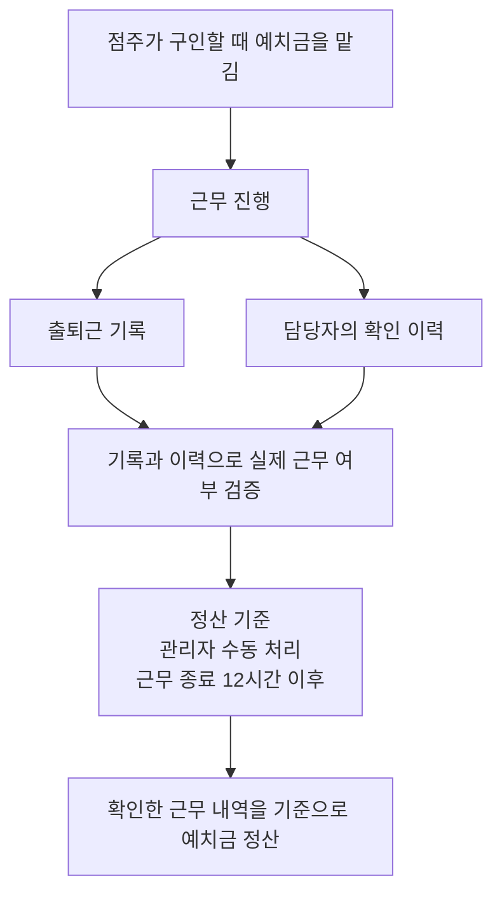
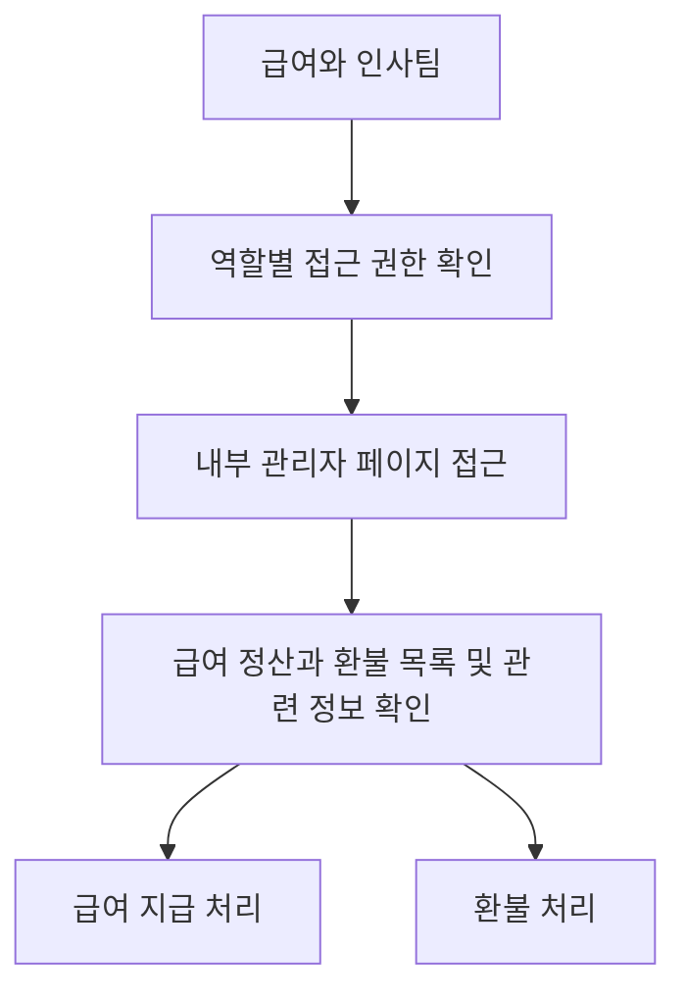
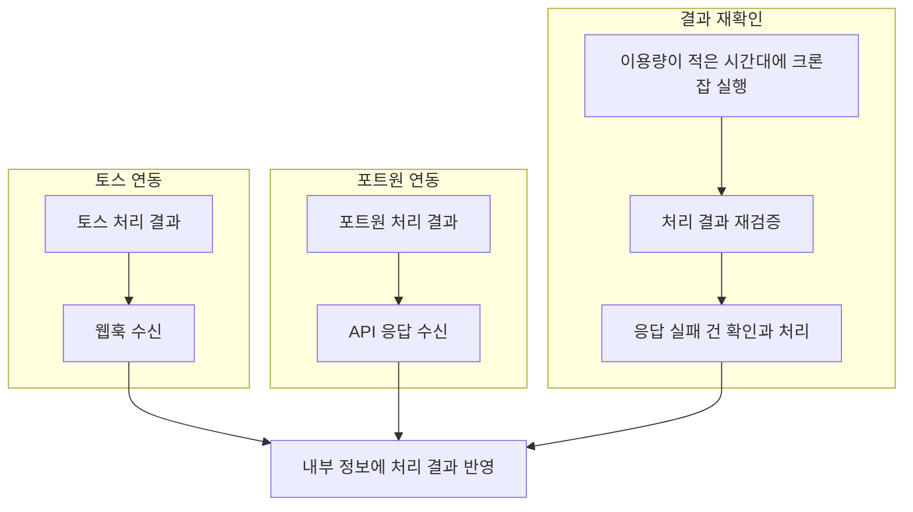

# 급여 정산과 환불 관리

[플랫폼 작업 목록](README.md)으로 돌아갑니다.

## 기본 정보

| 항목 | 내용 |
| --- | --- |
| 작업 기간 | 약 1개월 |
| 맡은 범위 | 서버, DB, 관리자 화면 단독 풀스택 개발 |
| 개발 상태 | 개발 완료 |
| 운영 상태 | 운영 중 |

## 왜 시작했는지

- 포트원과 토스의 관리자 화면에서 각각 환불을 처리하고 있었다.
- 그 과정에서 외부 서비스와 내부의 환불 정보가 서로 맞지 않는 문제가 발생했다.
- 급여 지급과 환불을 내부 관리자 페이지에서 처리하고 관련 정보를 맞춰 관리할 필요가 있었다.
- 실제 근무 여부를 확인할 데이터가 필요했다.
- 정산 관련 정보는 관리자 권한이 있는 사람만 볼 수 있어야 했다.

## 기술 스택

| 구분 | 기술 |
| --- | --- |
| 프론트엔드 | Vue.js, Nuxt.js 2 |
| 백엔드 | Node.js, Express |
| 데이터베이스 | MongoDB |
| 외부 연동 | 포트원, 토스 |

## 어떻게 해결했는지

- **통합 관리:** 급여 정산·환불 내역 조회와 지급·환불 실행을 내부 관리자 화면에서 처리
- **외부 연동:** 포트원·토스의 관련 정보를 내부 기록과 대조하고 처리 결과 동기화
- **정산 검증:** 출퇴근 기록과 담당자 확인 이력 검증 후 예치금 기준 정산
- **권한:** 급여·인사팀에 역할별 접근 권한 부여
- **실패 재확인:** 이용량이 적은 시간대에 크론잡으로 처리 상태를 점검하고 응답 실패 건 보완

## 예치금과 정산 흐름

1. 점주가 구인할 때 예치금을 맡긴다.
2. 출퇴근 기록과 담당자의 확인 이력을 확인해 실제 근무 여부를 검증한다.
3. 관리자 수동 처리와 근무 종료 12시간 이후 정산을 기준으로 운영한다.
4. 검증한 내용을 기준으로 맡겨 둔 예치금에서 정산한다.

### 예치금 정산 순서도

### 내부 관리자 페이지 처리 흐름

## 처리 결과를 반영한 방법

- **토스:** 웹훅으로 수신한 처리 결과를 내부 기록에 반영
- **포트원:** API 응답의 처리 결과를 내부 기록에 반영
- **결과 재확인:** 이용량이 적은 시간대에 크론잡으로 상태와 응답 실패 건 재검증

## 결과와 현재 상태

급여 지급부터 환불 실행·내역 조회까지 내부 관리자 시스템에서 처리하도록 통합해 재직 당시 운영에 반영했습니다. 외부 결제사와 내부 기록의 상태를 맞추기 위해 웹훅·API 응답과 정기 재확인을 함께 사용했습니다.

