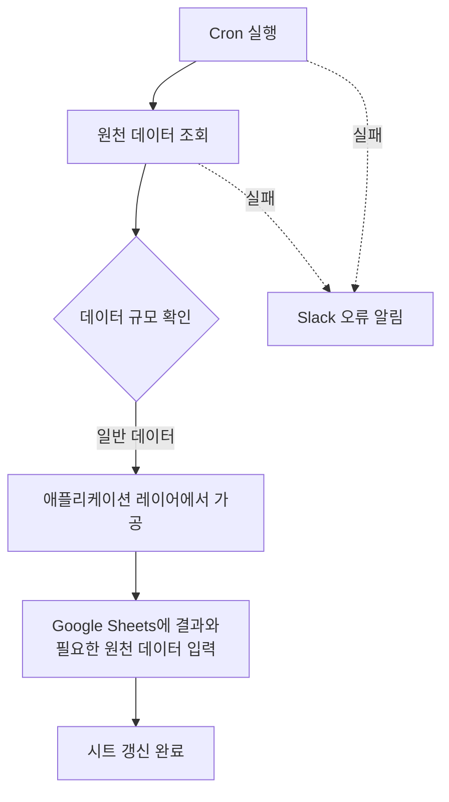
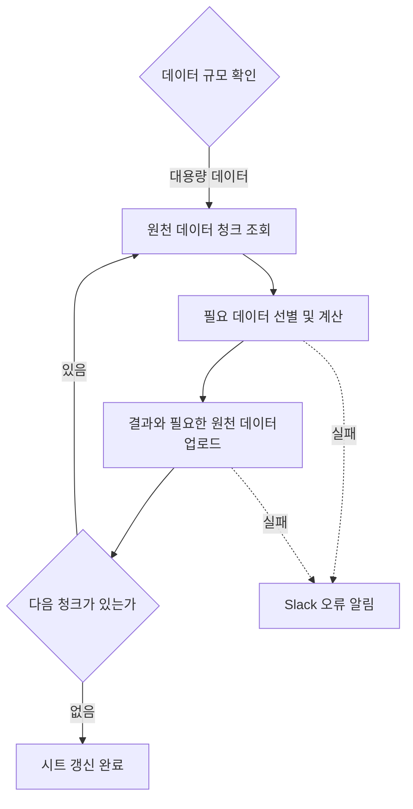

# 운영 데이터 집계와 Google Sheets 자동화

[공공 교육 플랫폼 작업 목록](README.md)으로 돌아갑니다.

수동으로 원천 데이터를 받아 다시 조합하던 반복 업무를 분석하고, 데이터 규모에 맞는 처리 방식으로 집계와 Google Sheets 이관을 자동화했습니다.
18개 시트의 정기 생성과 갱신, 실패 알림을 자동화했습니다. 약 1천만 건 규모의 원천 데이터도 전체 메모리에 적재하지 않고 청크 단위로 처리했습니다.

## 기본 정보

| 항목 | 내용 |
| --- | --- |
| 작업 기간 | 2025-11 이후 근무 중 진행 |
| 맡은 범위 | 수동 데이터 업무 분석, 자동화 제안, 데이터 조회와 가공, Google Sheets 이관, 오류 알림 구성 |
| 개발 상태 | 개발 완료 |
| 운영 상태 | 운영 중 |

## 왜 시작했는지

운영 데이터를 수동으로 전달받아 가공하고 Google Sheets에 옮기는 작업이 반복되고 있었습니다.
시트마다 필요한 데이터와 가공 방식이 달랐고, 일부 작업은 원천 데이터가 약 1천만 건 규모여서 전체 데이터를 한 번에 읽어 처리하기 어려웠습니다.

반복 작업을 줄이고 같은 기준으로 데이터를 생성할 수 있도록 기존 수동 업무를 분석한 뒤 자동화를 제안했습니다.

## 기술 스택

| 구분 | 기술 |
| --- | --- |
| 언어 | TypeScript |
| 데이터 처리 | SQL, 애플리케이션 레이어 집계, 청크 처리 |
| 자동화 | Cron |
| 외부 연동 | Google Sheets, Slack |

## 어떻게 해결했는지

### 수동 업무를 자동 실행 구조로 전환

- **집계 기준:** 수동으로 취합하던 원천 데이터와 시트별 가공 기준 정리
- **정기 실행:** Cron을 통한 조회, 가공 및 18개 Google Sheets 갱신 자동화
- **데이터 이관:** 집계 결과와 운영 확인용 원천 데이터의 업로드 경로 구성

### 데이터 규모에 따른 처리 방식 분리

데이터 규모가 작은 작업은 조회한 데이터를 애플리케이션 레이어에서 필요한 형태로 정리하고 바로 Google Sheets에 입력했습니다.

원천 데이터가 약 1천만 건 규모인 작업은 전체 데이터를 한 번에 메모리에 올리지 않았습니다.

1. 데이터를 일정 단위로 나눠 조회했습니다.
2. 각 청크에서 시트에 필요한 데이터만 선별하고 계산했습니다.
3. 처리한 데이터는 다음 청크를 읽기 전에 정리했습니다.
4. 가공 결과와 필요한 원천 데이터를 순차적으로 Google Sheets에 업로드했습니다.

대용량 데이터는 조회, 계산, 업로드를 청크별로 수행해 전체 데이터를 메모리에 적재하지 않도록 했습니다.

### 오류 확인

Cron 실행이나 데이터 처리 중 문제가 발생하면 Slack으로 오류 내용을 전달하도록 구성했습니다.
운영 중 자동 작업이 실패해도 담당자가 문제를 확인하고 후속 조치할 수 있게 했습니다.

## 처리 흐름

### 규모 확인과 일반 데이터 처리

### 대용량 청크 처리

데이터 규모에 따라 일반 처리 또는 청크 처리로 분기합니다. 두 그림의 시트 갱신과 Slack 오류 알림은 같은 경로를 나타냅니다.

## 결과와 현재 상태

수동으로 생성하던 18개 Google Sheets를 정기적으로 생성, 갱신하는 흐름으로 전환해 운영 중입니다. 약 1천만 건 규모의 원천 데이터는 전체 메모리에 적재하지 않고 처리하며, 실패 시 Slack 알림으로 후속 조치할 수 있게 했습니다.
