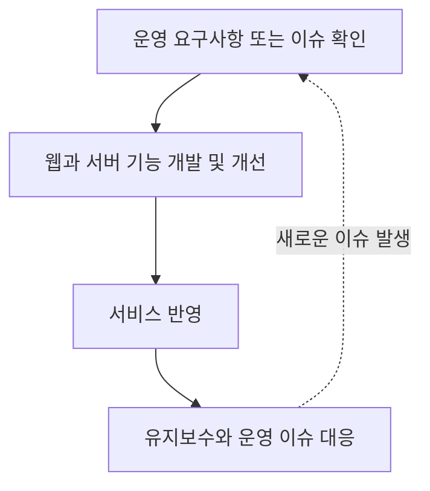

# 공공 교육 플랫폼 개발과 운영

[공공 교육 플랫폼 작업 목록](README.md)으로 돌아갑니다.

NCP 환경에서 여러 공공 교육 서비스의 교육, 예약, 출결, 관리자 기능을 개발하고 운영하고 있습니다.

## 기본 정보

| 항목 | 내용 |
| --- | --- |
| 작업 기간 | 2025-11 ~ 현재 |
| 맡은 범위 | 백엔드 기능 개발, 일부 React 웹 개발, API 개선, 유지보수와 운영 이슈 대응 |
| 개발 상태 | 개발과 유지보수 중 |
| 운영 상태 | 운영 중 |

## 배경과 과제

기존 공공 교육 플랫폼은 교육, 예약, 출결, 관리자 기능이 서로 연결되어 있어 한 기능의 변경이 다른 업무 흐름에 미치는 영향도 고려해야 했습니다. 운영 안정성을 유지하면서 신규 요구사항을 반영하고 기존 API와 데이터 처리 구조를 개선하는 것이 주요 과제였습니다.

## 기술 스택

| 구분 | 기술 |
| --- | --- |
| 언어 | TypeScript |
| 프론트엔드 | React |
| 백엔드 | NestJS, Node.js, TypeORM |
| 데이터베이스 | MySQL |
| 인프라 | NCP |

## 어떻게 해결했는지

- **서비스 개발:** 교육, 예약, 출결 및 관리자 기능의 백엔드 API 개발과 일부 React 화면 연동
- **레거시 개선:** 기존 코드의 데이터 접근 방식과 응답 형식 정리
- **운영 대응:** NCP 환경에서 서비스 유지보수, 요구사항 반영 및 장애, 이슈 대응

## 업무 흐름

## 결과와 현재 상태

운영 요구사항을 반영한 API 및 일부 웹 기능 개발과 기존 구조 개선을 지속하고 있습니다. 예약 메시지 전환, 출결, 예약 정합성 개선, 운영 데이터 자동화 등 구체적인 변경과 결과는 개별 작업 문서에서 확인할 수 있습니다.
