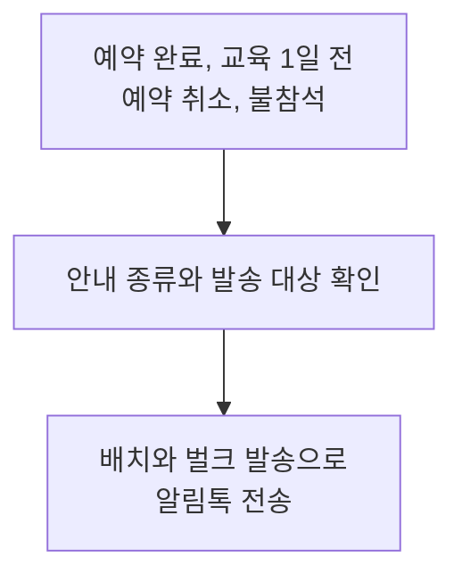

# 예약 메시지 발송 비용 개선

[공공 교육 플랫폼 작업 목록](README.md)으로 돌아갑니다.

예약 안내 메시지를 LMS에서 알림톡으로 전환해 운영에 반영했습니다. 76,000건 발송을 가정하면 약 171만 원(75%)의 비용 절감이 예상됩니다. 실제 청구 금액에 기반한 실적은 아닙니다.

## 기본 정보

| 항목 | 내용 |
| --- | --- |
| 작업 기간 | 2025-11 이후 근무 중 진행 |
| 맡은 범위 | 서비스 코드 검토, 비용 개선안 제안과 협의, 서버 발송 로직 개선 |
| 개발 상태 | 개발 완료 |
| 운영 상태 | 운영 중 |

## 배경과 과제

예약 취소와 재예약에 따른 반복 발송 비용을 줄이기 위해 알림톡 전환을 제안했습니다.

## 기술 스택

| 구분 | 기술 |
| --- | --- |
| 언어 | TypeScript |
| 백엔드 | NestJS, TypeORM |
| 데이터베이스 | MySQL |
| 메시지 발송 | NCP SENS |

## 어떻게 해결했는지

기존 LMS 발송 지점과 시점, 대상 규모를 분석하고 예약 완료, 교육 1일 전, 예약 취소, 불참석 안내의 알림톡 전환 범위를 정했습니다.

- **전환 협의:** 관련 부서, 기획 담당자, 경영진과 비용 개선안을 검토하고 개발 범위 확정
- **발송 로직:** 배치 및 벌크 발송의 LMS 의존 구간을 알림톡 기반으로 변경
- **운영 적용:** 전환한 발송 경로를 서비스에 반영

## 발송 흐름

## 비용 산정

계약 지역 10곳, 대상 38,000명에게 예약 완료와 교육 1일 전 안내를 각각 한 번 보낸다고 가정했습니다.
이 두 가지 안내만 계산한 발송량은 76,000건입니다.

| 항목 | LMS | 알림톡 |
| --- | --- | --- |
| 적용 단가 | 30원 | 7.5원 |
| 예상 발송 비용 | 2,280,000원 | 570,000원 |

이 조건에서 예상 절감액은 1,710,000원이며, 발송 단가와 예상 비용은 75% 낮아집니다.
실제 청구 금액을 비교한 실적이 아닌, 위 단가와 발송량을 적용한 예상 금액입니다.
취소, 불참석 안내와 반복적인 취소 및 재예약에 따른 추가 발송은 이 계산에 포함하지 않았습니다.
따라서 실제 발송량과 기존 LMS 비용은 이 예시보다 커질 수 있습니다.
같은 단가를 적용하면 추가 발송량에 비례해 알림톡 전환으로 줄일 수 있는 비용도 늘어납니다.

## 결과와 현재 상태

예약 안내의 알림톡 발송 경로를 운영에 적용했습니다. 발송 건당 비용을 낮춰 대상 인원과 발송량이 늘어날 때의 비용 부담을 줄이는 방식이며, 실제 절감 실적은 청구 내역으로 별도 확인해야 합니다.
