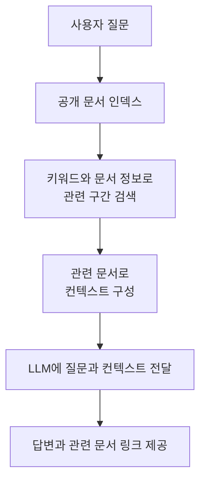

# 사이트 소개

백엔드 개발 과정에서 마주한 문제, 설계 판단, 구현 과정과 결과를 정리한 기술 포트폴리오입니다. 회사 및 사이드 프로젝트별 역할 분담, 기술 스택, 검증 근거와 운영 상태를 확인할 수 있습니다.

## AI 질문 기능

프로젝트나 기술에 대해 질문하면 공개 경력 문서에서 관련 내용을 찾아 요약하고 원문 링크를 제공합니다.

공개 문서 검색 결과를 컨텍스트로 활용하는 LLM 질문 기능입니다. 질문의 핵심 키워드와 문서 제목, 분류, 본문을 비교해 관련 구간을 선택하며 임베딩이나 벡터 DB는 사용하지 않습니다.

## 문의와 정정

개별 문의는 [kim.h.g199510@gmail.com](mailto:kim.h.g199510@gmail.com)으로 보내 주세요. 문서 수정이나 사이트 오류는 [GitHub Issues](https://github.com/KimHG1995/work-history/issues)로 알려 주세요. GitHub Issues에 작성한 내용은 공개되므로 개인정보나 비밀값은 입력하지 마세요.

방문 분석과 질문 기능의 정보 처리는 [개인정보 안내](./privacy.md)에서 확인할 수 있습니다.
